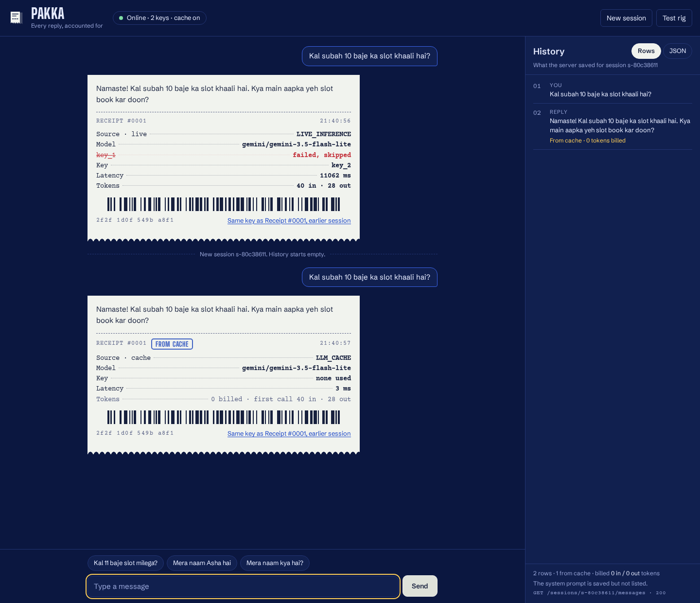
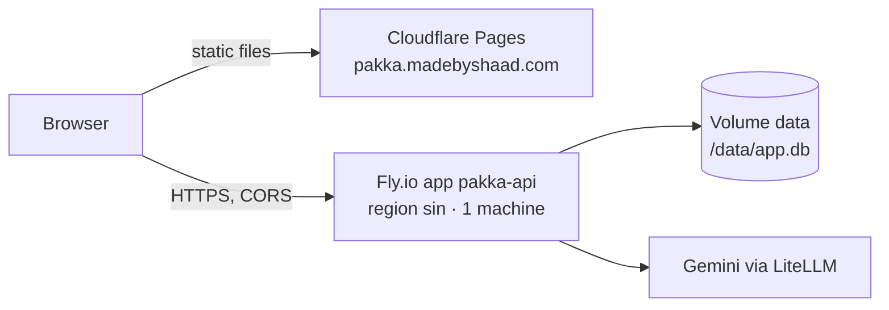
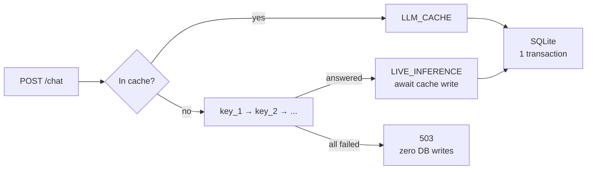
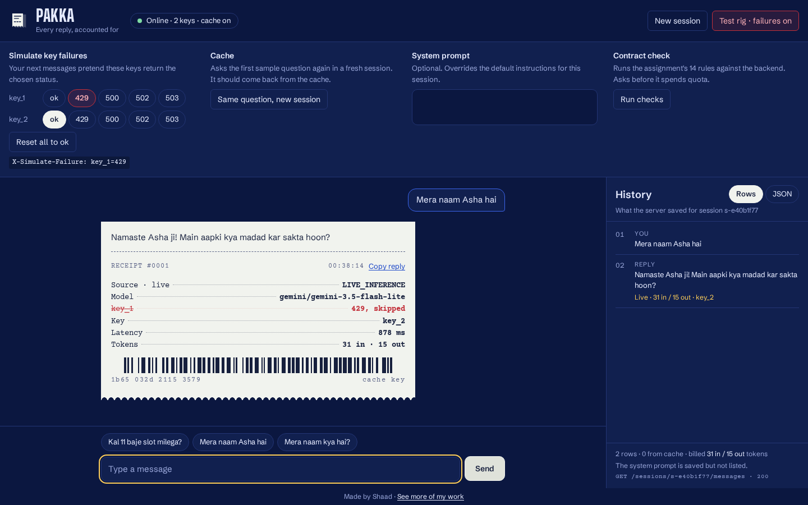
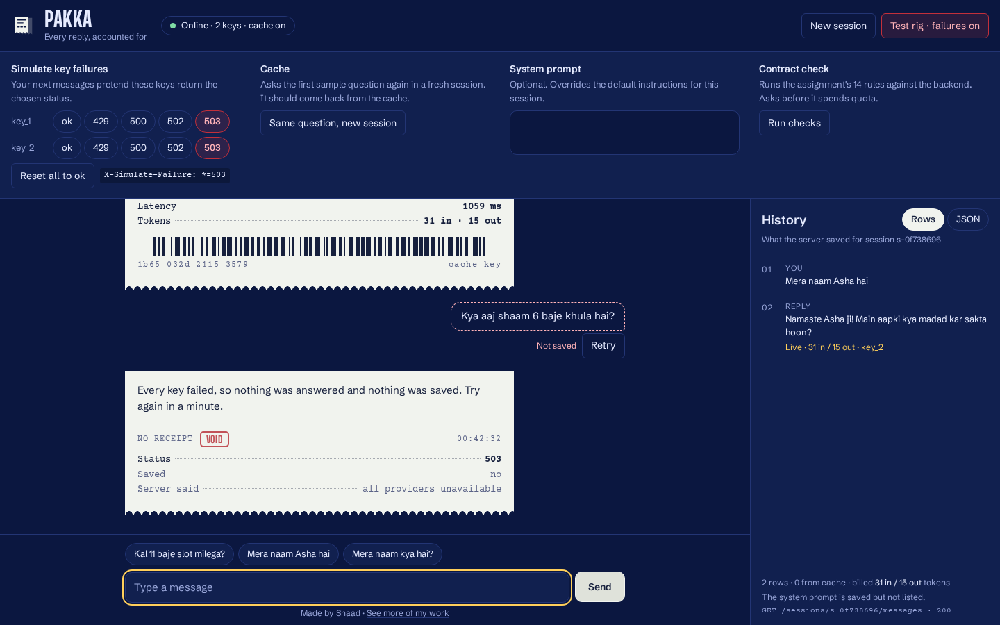
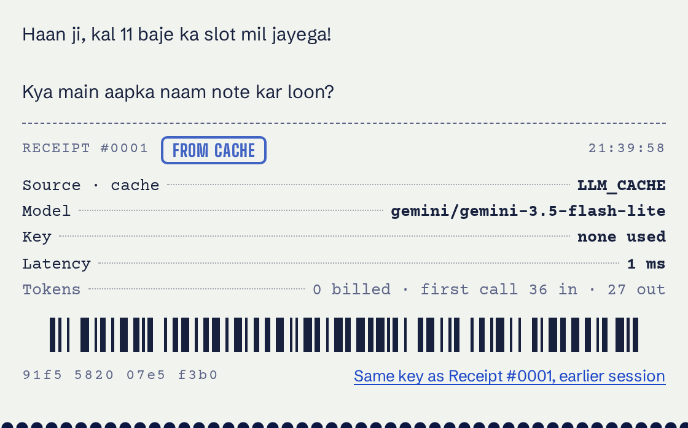
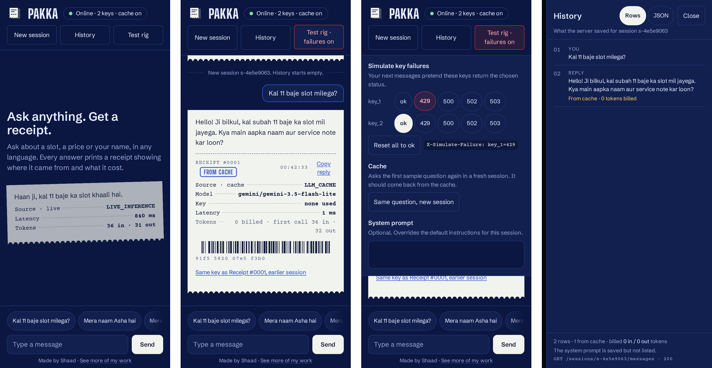

<p align="center">
  <picture>
    <source media="(prefers-color-scheme: dark)" srcset="docs/images/banner-dark.png">
    <source media="(prefers-color-scheme: light)" srcset="docs/images/banner.png">
    
  </picture>
</p>

23:04. The shop is closed. A customer asks for a morning slot, and `key_1` ran out of quota an hour ago.

**The customer still gets an answer.**

**Pakka** is a chatbot that keeps answering when things break, and prints a receipt under every reply to show you how. In an Indian shop, a *pakka* bill is the proper, printed one.

| When this happens | Pakka does this | The receipt shows |
|---|---|---|
| A key runs out or fails | Asks the next key | `key_1` struck through · *429, skipped* · Key `key_2` |
| The same question comes again | Reuses the saved answer for free | `LLM_CACHE` · *From cache* · 0 billed |
| Every key fails | Says so in one sentence and saves nothing | A red VOID slip · *not saved* |
| Any reply | Counts what that one reply used | Latency · input and output tokens |

<p align="center">
  
  <br><sub>A live answer in 1 s, then the same question in a new session from the cache in 1 ms, 0 tokens billed.</sub>
</p>

> **Grading on a clock?** Open the app, open **Test rig**, press **Run checks**, then **Start**. All 14 contract rules run live from your browser.
>
> **Status:** 38/38 backend tests · 14/14 live checks on `gemini/gemini-3.5-flash-lite` · deployed at [pakka.madebyshaad.com](https://pakka.madebyshaad.com)

---

## 1. Live URLs

| | |
|---|---|
| Frontend | https://pakka.madebyshaad.com |
| Backend | https://pakka-api.fly.dev |
| Health | https://pakka-api.fly.dev/health |
| Demo video | [Google Drive](https://drive.google.com/drive/folders/1ny6nrKRVTnKhryqJB12iWHoIzVF8sHYg?usp=sharing) |

- `ENABLE_FAILURE_SIMULATION=true` is on in production ([`backend/fly.toml`](backend/fly.toml)), so `X-Simulate-Failure` works on the live URL.
- Fly stops the machine when it's idle. The first request after that is slower, and the in-memory cache starts empty: the first repeat runs live, the next one hits `LLM_CACHE`. History is safe on the volume.
- Gemini sometimes answers `503` with "high demand" for a few seconds. That hits every key on the model at once, so the app retries the same key once before moving on. A longer spike still ends in a clean `503`.

### Deployment



| Part | Where | Details |
|---|---|---|
| Frontend | Cloudflare Pages, project `pakka` | Static Vite build. The API URL is baked in at build time through `VITE_API_BASE_URL` |
| Backend | Fly.io app `pakka-api`, region `sin` | The `runtime` stage of `backend/Dockerfile`, on one `shared-cpu-1x` machine with 512 MB |
| Data | Fly volume `data`, 1 GB, at `/data` | Holds `/data/app.db`. A volume belongs to one machine, so the app stays at **one machine** |
| Secrets | `LLM_API_KEYS` as a Fly secret | Never in git, never in `fly.toml` |

**CI/CD.** [`ci.yml`](.github/workflows/ci.yml) runs on every push and pull request: pytest, the frontend build and Playwright tests, gitleaks over the full history, Semgrep, `pip-audit`, `npm audit`, hadolint and Trivy. One `CI passed` gate guards `main`. When it's green on `main`, the backend deploys to Fly first and the frontend to Cloudflare second, so a new UI never meets an old API.

<details>
<summary><b>First-time setup, redeploy, rollback</b></summary>

```bash
# Backend, from backend/
fly launch --no-deploy --copy-config --org personal
fly volumes create data --size 1 --region sin
fly secrets set LLM_API_KEYS="key1,key2"
fly deploy --remote-only

# Frontend, from frontend/
VITE_API_BASE_URL=https://pakka-api.fly.dev npm run build
npx wrangler pages deploy dist --project-name pakka --branch main

# Roll back the backend
fly releases -a pakka-api
fly deploy -a pakka-api --image <image from an older release>
```

- The pipeline reads `FLY_API_TOKEN`, `CLOUDFLARE_API_TOKEN` (Pages: Edit only) and `CLOUDFLARE_ACCOUNT_ID` from the GitHub environment `production`.
- Roll back the frontend in Cloudflare: Workers & Pages, `pakka`, Deployments, Rollback.
- Fly snapshots the volume daily (`fly volumes snapshots list`).
- A new frontend domain needs a matching `ALLOWED_ORIGINS` and a backend deploy, or the browser fails on CORS.

</details>

---

## 2. Run locally: with Docker and without

```bash
cp .env.example .env     # put 2+ real keys in LLM_API_KEYS
make up                  # backend :8000 · frontend :3000
make test                # 38 pytest cases inside the image
make verify              # 14 live contract checks (Node 18+)
(cd frontend && npm test)          # barcode decode + 21 Playwright tests at 1440 and 390 px, local test backend
(cd frontend && npm run test:live) # the same UI against the real stack from make up
make down
```

- History lives on the named volume `appdata`, at `/data/app.db`. It survives `make down` and restarts.
- **No keys?** Set `LLM_MOCK_RESPONSE=anything` in `.env`. Failover, caching and SQLite still run for real. Use `make verify ARGS=--no-memory`, since a fixed reply can't remember your name.

<details>
<summary><b>Without Docker</b></summary>

```bash
cd backend
uv venv --python 3.12 .venv && uv pip install --python .venv/bin/python -r requirements-dev.txt
export LLM_API_KEYS=key-one,key-two DATABASE_URL=sqlite:///./app.db ENABLE_FAILURE_SIMULATION=true
.venv/bin/uvicorn app.main:create_app --factory --port 8000 --workers 1

cd ../frontend && npm ci && npm run dev   # http://localhost:3000
```

</details>

Every variable is in [`.env.example`](.env.example), with a one-line note. Point every key at the same model: the cache key is the model plus the messages, so an answer from `key_1` stays right for `key_2`.

---

## 3. Design decisions: key fallback, caching, SQLite session storage



LiteLLM was new to me, so I tested `1.110.3` in small scripts before building on it. 4 things surprised me, and they shaped everything below:

1. **`caching=True` writes in the background.** An immediate repeat can miss.
2. **There's no disk cache in `1.110.3`.** With Redis ruled out, the cache lives in memory.
3. **Only 2 of its test errors raise.** `litellm.ServiceUnavailableError` comes back as reply text, inside a 200.
4. **`Router` deep-copies `model_list`.** Exception objects crash on copy.

### Key fallback

> The keys wait in a line. If one fails, the next one answers.

- One LiteLLM `Router`, 1 deployment per key (`model_info.id = key_id`), chained `key_1` → `key_2` → ... with `num_retries=0`.
- `key_1` always goes first, so `fallback_attempts` is the answering key's place in line.
- The answering key comes from `_hidden_params["model_id"]`. The key itself never appears in a response or a log.
- The line moves on after a 429, a quota error, a 5xx, a timeout or an empty answer. When every key fails: `503 {"detail": "all providers unavailable"}`.
- A provider `503` first gets one retry on the same key, about 1 s later. Gemini's "high demand" spikes hit every key on the model, so switching keys can't help there.
- A request with `X-Simulate-Failure` gets its own short-lived `Router` with the named keys set to fail, and skips the cache. The real fallback code runs, isolated from normal traffic.

**Where it stops:** `502` and `503` drills run as LiteLLM's `500` (surprise 3), and the status you asked for is kept in `metadata.attempts`. 2 hung keys at a 15 s timeout can hold a request for 30 s before the `503`.

### Caching

> The same question, in the same context, gets the saved answer. The model is never called.

- LiteLLM's `Cache(type="local")`, called by hand: read before the `Router`, then **await `async_add_cache`** after a live answer (surprise 1). That's why an immediate repeat in a new session returns `LLM_CACHE`.
- The key is `model` + the full message list: system prompt, history, new message. Change 1 word and it misses.
- A warm-up read at startup pays LiteLLM's one-off import cost, so the first real hit stays around `1 ms`.
- A failed cache write is logged and skipped. The user still gets their answer.

**Where it stops:** memory dies on restart, so `uvicorn` runs **1 worker, on purpose**. A 2nd worker would hold a 2nd, empty cache. An exact-match cache also assumes answers don't change, so a shop that changes its hours would add a catalog version or a TTL to the key.

### SQLite session storage

> A turn is saved only after its answer arrives. A failure leaves no trace.

- The contract's `messages` table, plus an index on `(session_id, id)`. A small `sessions` table holds each session's `system_prompt`, so it never shows up in `GET /sessions/{session_id}/messages`.
- The browser sends only the new message. The server rebuilds the conversation from SQLite on every call.
- A finished turn commits in **1 transaction**: session, user row, assistant row. A `422` or `503` writes nothing.
- A per-session `asyncio.Lock` keeps 2 fast messages in order. WAL mode, off the event loop through `asyncio.to_thread`.

---

## 4. Verification: how to see failover, cache hits and per-message token usage

> A renamed field counts as a missing requirement. So the contract checks itself.

Open **Test rig** and press **Run checks**, or run `make verify URL=https://your-backend`. Both run one file, [`checks.js`](frontend/src/inspection/checks.js), so they can't drift apart. About 5 live model calls, 14 checks:

| Area | Checks |
|---|---|
| Health | `/health` is up, 2+ keys, cache on |
| Bad input | 4 kinds refused with `422` |
| Cache | A fresh question is live. The same one in a new session comes from the cache |
| Failover | `key_1` fails with `429`, then `500`: `key_2` answers both times |
| Outage | Every key fails: `503`, and the session was never saved (`404`) |
| History | Oldest first, and the bot remembers earlier messages |
| Secrets | No key appears in any response |

**See it yourself in 30 seconds:**

| To see | Do this | Look for on the receipt |
|---|---|---|
| **Tokens per message** | Send any question | The `Tokens` line: input and output for that one turn |
| **A cache hit** | Ask *Kal 11 baje slot milega?*, then in **Test rig** click **Same question, new session** | `LLM_CACHE`, a blue **From cache** stamp, ~`1 ms`, *0 billed*, the same barcode |
| **Failover** | In **Test rig**, set `key_1` to `429`, then send | `key_1` struck through, *429, skipped*, Key `key_2` |
| **Every key down** | In **Test rig**, set every key to `429`, then send | A red **VOID** slip, *Not saved* with **Retry**, **History** still `404` |

<table>
  <tr>
    <td width="50%"></td>
    <td width="50%"></td>
  </tr>
  <tr>
    <td><sub><b>Failover.</b> <code>key_1</code> returns <code>429</code>, so <code>key_2</code> answers. The receipt keeps the skipped key.</sub></td>
    <td><sub><b>Every key down.</b> A readable <code>503</code>, <i>Not saved</i> with <b>Retry</b>, and History unchanged.</sub></td>
  </tr>
</table>

<table>
  <tr>
    <td width="55%"></td>
    <td>

| Line | Means |
|---|---|
| **Source** | `LIVE_INFERENCE` or `LLM_CACHE`, as the API sent it |
| **Key** | Who answered. Failed keys print above it, struck through |
| **Tokens** | What this reply used. A cache hit bills 0 and shows the first call's counts |
| **Barcode** | Real Code 128 of the cache key |

</td>
  </tr>
</table>

<details>
<summary><b>The same, with curl</b></summary>

```bash
B=http://localhost:8000; J='content-type: application/json'

curl -s $B/chat -H "$J" -d '{"session_id":"s-1","message":"What is the capital of France?"}' | jq .metadata
curl -s $B/chat -H "$J" -d '{"session_id":"s-2","message":"What is the capital of France?"}' | jq .metadata   # LLM_CACHE
curl -s $B/chat -H "$J" -H 'X-Simulate-Failure: key_1=429' -d '{"session_id":"s-3","message":"hi"}' | jq .metadata   # key_2
curl -s -i $B/chat -H "$J" -H 'X-Simulate-Failure: *=429' -d '{"session_id":"s-4","message":"hi"}'   # 503
curl -s -i $B/sessions/s-4/messages   # 404: the failed turn left no rows
curl -s $B/sessions/s-1/messages | jq
```

</details>

| ✓ Proven | ✗ Not yet |
|---|---|
| 38 pytest cases, no real model calls | A clean, labelled `429` from Google |
| 14/14 live checks, local and deployed | `Router` cooldown after a real rate limit |
| Live ~1.4 s against cached 1 ms, real token counts, memory | Two separate quotas: both keys share 1 account |

---

## 5. Setup Used

- **Editor:** VS Code
- **AI tools:** Claude Code and Antigravity. I read and tested every change before keeping it.
- **By hand:** spike scripts against LiteLLM `1.110.3` before writing the gateway, then live contract checks against Gemini.

---

## 6. Bonus features (if any)

> Everything graded here happens out of sight. So I put it on paper.

| Addition | Why it's there |
|---|---|
| **Thermal receipts** | Source, key chain, latency and tokens, readable at a glance |
| **Cache-key barcode** | A real Code 128 of the first 16 hex characters of `metadata.cache_key`. A *Same key as Receipt #…* link jumps to the matching receipt |
| **Test rig** | Operator tools kept out of the chat: `ok · 429 · 500 · 502 · 503` per key with the exact header, the cache demo, the system prompt and Run checks |
| **VOID slip + History drawer** | A readable `503`, next to live `GET /sessions/{id}/messages` proving the failed turn is still `404` |
| **Run checks (14/14)** | The grader's checklist, run by the app itself. It asks before spending ~5 model calls |

<p align="center">
  
  <br><sub>At 390 px: the first screen, a cache hit, the Test rig, the History drawer.</sub>
</p>

- **Extras are fields only:** `cache_key` and `attempts` on `/chat`, `simulation_enabled` and `model` on `/health`. No new endpoints.
- **Remove every shop word** from the UI, and every path, field and `data-testid` still meets the spec.
- **No rupee cost on the receipt.** I haven't verified this model's price, and I won't print a number I can't stand behind.

---

<p align="center"><i>At 11 PM, a customer doesn't care which key ran out. Only that someone answered.</i></p>
