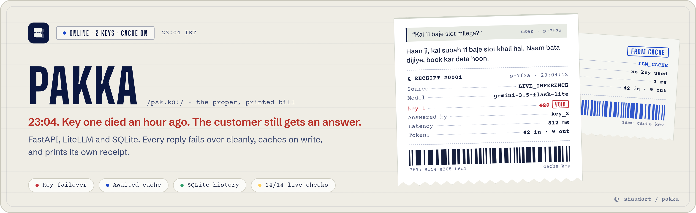
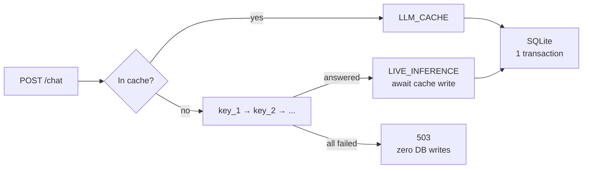

<p align="center">
  <picture>
    <source media="(prefers-color-scheme: dark)" srcset="docs/images/banner-dark.png">
    <source media="(prefers-color-scheme: light)" srcset="docs/images/banner.png">
    
  </picture>
</p>

23:04. A shopkeeper puts the phone down for the night. 10 minutes later a lead asks for a morning slot, and `key_1` ran out of quota an hour ago.

In most chatbots, the 3 things that save that reply happen in the dark: `key_2` steps in, a repeat question comes off the shelf, and a failed turn stays out of the database.

**Pakka** prints all 3 on a thermal receipt under every reply. In an Indian shop, a *pakka* bill is the proper, printed one.

**Grading on a clock?** Open the app and press **Run checks**. All 14 contract rules run live from your browser and print one pass/fail slip.

> **Where it stands:** 37/37 backend tests pass. 14/14 contract checks pass live against `gemini/gemini-3.5-flash-lite`. Deployment URLs pending.

---

## 1. Live URLs

| Surface | Link |
|---|---|
| Frontend | TBD |
| Backend | TBD |
| Health | `<backend>/health` |
| Demo video | TBD |

`ENABLE_FAILURE_SIMULATION=true` is on in production, so `X-Simulate-Failure` works against the live URL.

The cache lives in process memory. If a free-tier host sleeps, it wakes up with an empty shelf: the first repeat runs live, and the next one hits `LLM_CACHE`.

---

## 2. Run locally: with Docker and without

### With Docker

```bash
cp .env.example .env     # put 2+ real keys in LLM_API_KEYS
make up                  # backend :8000 · frontend :3000
make test                # 37 pytest cases inside the image
make verify              # 14 live contract checks (Node 18+)
make down
```

SQLite history lives on the named volume `appdata` at `/data/app.db`, so sessions survive `make down` and container restarts.

**Testing without keys?** Set `LLM_MOCK_RESPONSE=anything` in `.env`. Every healthy key answers locally, and failover, caching and SQLite behave for real. Run `make verify ARGS=--no-memory` (a fixed string can't remember your name).

### Without Docker

```bash
cd backend
uv venv --python 3.12 .venv && uv pip install --python .venv/bin/python -r requirements-dev.txt
export LLM_API_KEYS=key-one,key-two DATABASE_URL=sqlite:///./app.db ENABLE_FAILURE_SIMULATION=true
.venv/bin/uvicorn app.main:create_app --factory --port 8000 --workers 1

cd ../frontend && npm ci && npm run dev   # http://localhost:3000
```

<details>
<summary><b>Environment variables</b></summary>

| Variable | Meaning |
|---|---|
| `LLM_API_KEYS` | Comma-separated key pool (2+). Mapped to `key_1`, `key_2`, ... in order |
| `DATABASE_URL` | SQLite path, e.g. `sqlite:////data/app.db` |
| `ALLOWED_ORIGINS` | Comma-separated CORS origins, exact scheme and host |
| `ENABLE_FAILURE_SIMULATION` | `true` enables the `X-Simulate-Failure` header (default `false`) |
| `LLM_MODEL` | LiteLLM model id (default `gemini/gemini-3.5-flash-lite`) |
| `DEFAULT_SYSTEM_PROMPT` | Fallback instructions when a session omits `system_prompt` |
| `LLM_TIMEOUT_SECONDS` | Per-key timeout before moving down the chain (default `15`) |
| `LLM_MOCK_RESPONSE` | Offline test reply; leave unset on a real deployment |
| `VITE_API_BASE_URL` | Frontend build arg pointing the browser at the backend |

Point every key in the pool at the same model. LiteLLM hashes the model and messages into the cache key, so a cached answer from `key_1` stays accurate for `key_2`.

</details>

---

## 3. Design decisions: key fallback, caching, SQLite session storage



LiteLLM was new to me. Before wiring the app, I tested `1.110.3` in small standalone scripts and hit 4 surprises that shaped the backend:

1. **`caching=True` writes in the background.** Fire an immediate repeat and it can miss.
2. **Disk caching is gone in `1.110.3`.** With Redis and external stores off-limits, in-memory local cache is the honest option.
3. **Only 2 mock errors actually raise.** `litellm.ServiceUnavailableError` comes back as 200 reply text.
4. **`Router` deep-copies `model_list`.** Passing raw exception objects crashes on copy.

### Key fallback

One LiteLLM `Router` holds 1 deployment per key (`model_info.id = key_id`), chained in order (`key_1` → `key_2` → ...) with `num_retries=0`. `key_1` always tries first, so `fallback_attempts` is just the answering key's index. The winner comes from `_hidden_params["model_id"]`; actual secret strings stay out of responses and logs.

On 429s, quota errors, 5xx responses, timeouts or blank completions, the `Router` walks to the next key. If every key fails, `/chat` returns `503 {"detail": "all providers unavailable"}`.

When `X-Simulate-Failure` arrives, that single request spins up a throwaway `Router` wired with LiteLLM mock error strings and skips the cache read. The real fallback chain runs, and simulated cooldowns stay out of shared traffic.

**Where it stops.** Because of finding 3, `502` and `503` drills run as LiteLLM's `500` mock error under the hood (the exact status you requested is still preserved in `metadata.attempts`). And 2 hung providers at a 15s timeout can hold a request for 30s before the `503`.

### Caching

I call LiteLLM's `Cache(type="local")` directly: check before the `Router`, then **await `async_add_cache`** after a live answer. Waiting on the write guarantees that an immediate repeat in a fresh session returns `LLM_CACHE`.

The cache key hashes `model` + full message list (system prompt + session history + new message). Change 1 word and it misses. A warm-up lookup at startup pays LiteLLM's lazy import cost once, keeping the first real cache hit down around `1 ms`. If a cache write ever fails, Pakka logs it and still hands the user their answer.

**Where it stops.** Process memory dies on restart, so `uvicorn` runs **1 worker on purpose** (a 2nd worker would hold a separate cache). And exact-match caching assumes the shop's answers haven't changed; a live business changing its hours would salt the cache key with a catalog version or add a TTL.

### SQLite session storage

Plain `sqlite3` in WAL mode runs off the event loop via `asyncio.to_thread`, using the contract's `messages` table plus an index on `(session_id, id)`. A small `sessions` table stores the optional `system_prompt` separately so it never leaks into `GET /sessions/{session_id}/messages`.

The browser sends only the new message; the server rebuilds context from SQLite on every call. Completed turns commit in **1 transaction** (session upsert, user row, assistant row) behind a per-session `asyncio.Lock`. A `422` or `503` writes nothing.

---

## 4. Verification: how to see failover, cache hits and per-message token usage

A renamed field counts as a missing requirement, so I made the contract grade itself. Press **Run checks** in the header, or run:

```bash
make verify URL=https://your-backend
```

Both execute [`frontend/src/inspection/checks.js`](frontend/src/inspection/checks.js) (~5 live model calls across 14 checks: `/health`, four `422` cases, live inference, cross-session cache hit, `429` and `500` failovers, full `503` outage, `404` confirming nothing was stored, history order, multi-turn memory, and a scan ensuring no secret leaked).

To check each rule by hand in 30 seconds:

| Rule | Do this in the UI | Look for on the receipt |
|---|---|---|
| **Per-message tokens** | Send any question | `Input tokens` and `Output tokens` for that single turn |
| **Cache hit** | Click **Same question, new session** | `LLM_CACHE`, blue **From cache** stamp, ~`1 ms` latency, and **the exact same barcode** |
| **Key failover** | Click `key_1: ok` → `429`, then send | `key_1` struck through as **VOID**, `Answered by key_2` |
| **All keys down** | Set every key chip to `429`, then send | Red **VOID** slip, bubble marked `not saved`, **History** still returning `404` |

<details>
<summary><b>Verify with curl</b></summary>

```bash
B=http://localhost:8000; J='content-type: application/json'

curl -s $B/chat -H "$J" -d '{"session_id":"s-1","message":"What is the capital of France?"}' | jq .metadata
curl -s $B/chat -H "$J" -d '{"session_id":"s-2","message":"What is the capital of France?"}' | jq .metadata   # LLM_CACHE
curl -s $B/chat -H "$J" -H 'X-Simulate-Failure: key_1=429' -d '{"session_id":"s-3","message":"hi"}' | jq .metadata   # key_2
curl -s -i $B/chat -H "$J" -H 'X-Simulate-Failure: *=429' -d '{"session_id":"s-4","message":"hi"}'   # 503
curl -s -i $B/sessions/s-4/messages   # 404: failed turn left zero rows
curl -s $B/sessions/s-1/messages | jq
```

</details>

**What's proven, and what isn't.** 37 pytest cases pass on mocks, and all 14 live checks pass against `gemini/gemini-3.5-flash-lite` (`~1.2 s` live vs `1 ms` cached, real token counts, multi-turn memory, simulated failover). I haven't triggered a real `429` from Google: both keys in my test pool belonged to 1 account and shared one quota, so `Router` cooldown after a live provider rate limit remains unverified.

---

## 5. Setup Used

- **Editor:** VS Code
- **AI tools:** Claude Code and Antigravity for scaffolding, contract tests and README polish. I read, ran and fixed every generated file before keeping it.
- **By hand:** Spike scripts against LiteLLM `1.110.3` before writing the gateway, then live contract verification against Gemini.

---

## 6. Bonus features (if any)

Everything graded in this assignment happens out of sight, so I put it on paper:

| Addition | Why it's there |
|---|---|
| **Thermal receipts** | Turns invisible backend metadata (source, key chain, latency, per-turn tokens) into something you can read at a glance |
| **Cache-key barcode** | Drawn directly from `metadata.cache_key`. Equal inputs print identical bars; hover one and every match in the chat lights up |
| **Simulate failure bar** | Cycles each key through `ok / 429 / 500 / 502 / 503` and shows the exact `X-Simulate-Failure` header (visible only when `/health` reports `simulation_enabled`) |
| **VOID slip & History drawer** | Shows a readable `503` alongside live `GET /sessions/{id}/messages` output, proving failed turns stay at `404` |
| **Run checks (`14/14`)** | Runs the assignment checklist inside the browser so you can grade the live deployment in 1 click |

Extras stay strictly additive: `cache_key` and `attempts` inside `/chat` metadata, plus `simulation_enabled` and `model` on `/health`, with zero extra endpoints. Strip every shop metaphor out of the UI and every path, field and `data-testid` still meets the spec.

**2 quiet rules I kept.** I left rupee cost off the receipt because I haven't verified exact pricing for `gemini-3.5-flash-lite`, and I won't print a number I can't stand behind. And the tiny crescent on each receipt is there because a cache works like the moon: it has no light of its own, and only reflects what it already received.
